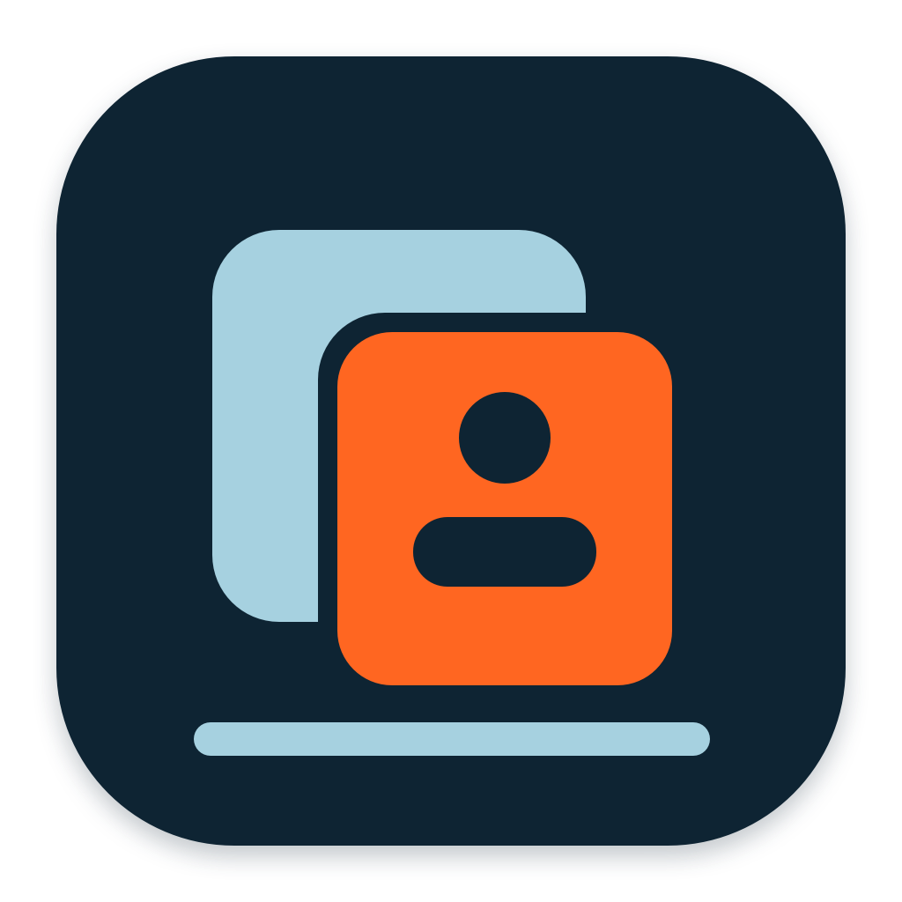
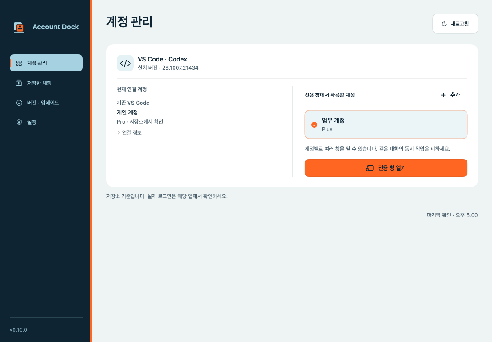
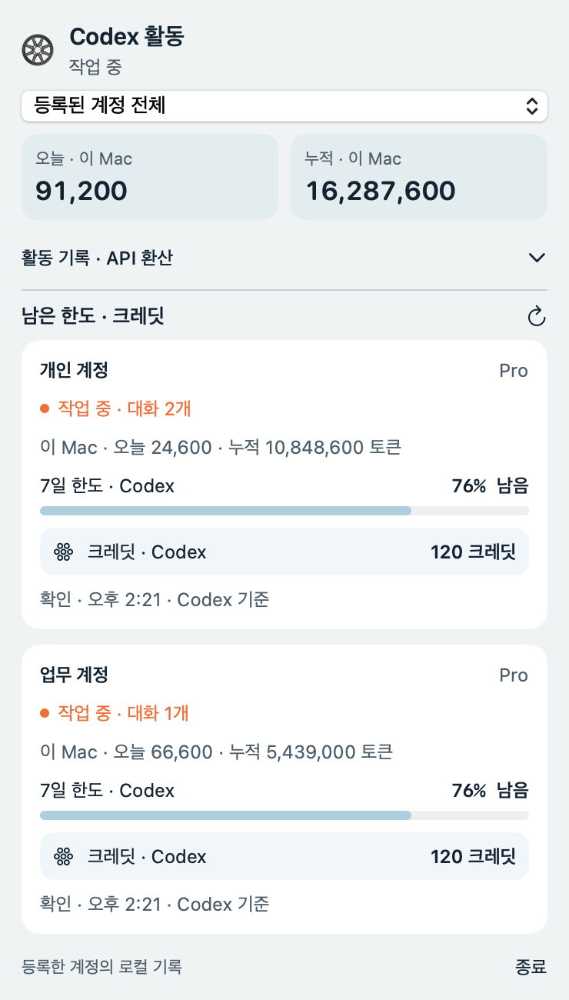
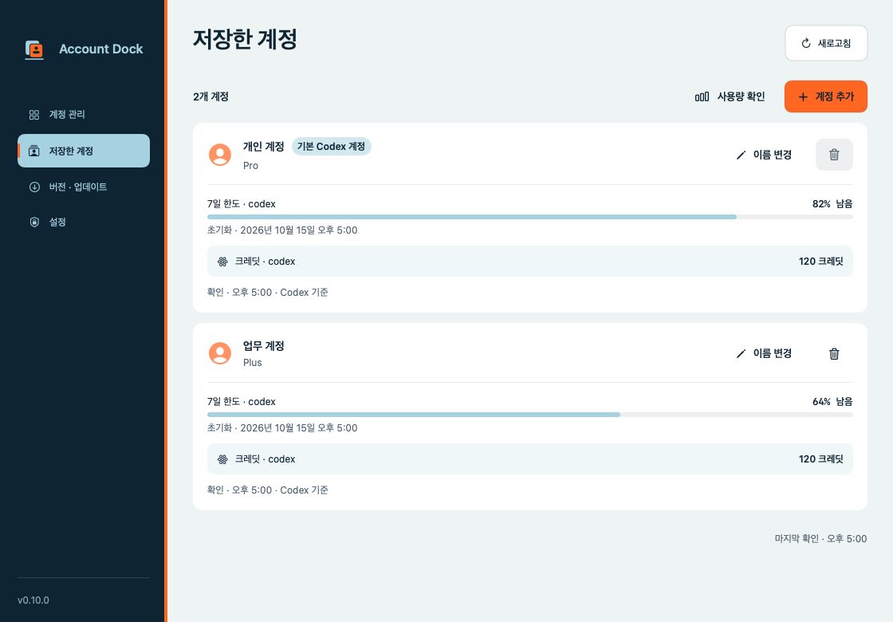

<p align="center">
  
</p>
<h1 align="center">Account Dock</h1>
<p align="center"><strong>Codex 계정별로 VS Code를 열고, 사용량을 확인하는 macOS 앱</strong></p>
<p align="center">
  <a href="https://github.com/z8086486/account-dock/releases"></a>
  
  
</p>
<p align="center">
  <a href="https://github.com/z8086486/account-dock/releases">다운로드</a> ·
  <a href="https://github.com/z8086486/account-dock/issues">버그 제보</a> ·
  <a href="ISOLATION.md">계정별 VS Code 안내</a>
</p>

개인 계정과 업무 계정처럼 **여러 Codex 계정을 함께 사용할 때** 계정별 로그인과 창을 관리합니다. 기존 VS Code는 그대로 두고, 등록한 다른 계정으로 별도의 VS Code를 열어 동시에 작업할 수 있습니다.

- **계정별 VS Code** — 저장한 계정을 선택해 실행하고, 같은 계정으로 창을 추가합니다. 기존 테마와 로컬 대화도 연결합니다.
- **사용 한도·크레딧** — 계정별 플랜과 남은 한도, 제공되는 크레딧 잔액을 확인합니다.
- **메뉴 막대 활동** — Codex 작업 중에는 휠이 회전합니다. 클릭하면 계정별 작업 상태와 로컬 토큰 사용 기록을 확인할 수 있습니다.



계정은 macOS Keychain에 보관합니다. 로그인 시 자동 실행과 앱 내 업데이트를 지원합니다.

## 설치

**macOS 14 이상 · Apple Silicon · VS Code + 공식 Codex 확장 필요**

1. [최신 릴리즈](https://github.com/z8086486/account-dock/releases)에서 DMG를 다운로드합니다.
2. **Account Dock.app**을 Applications 폴더로 옮겨 실행합니다.
3. 첫 접근 안내를 완료하고 **계정 추가**에서 로그인합니다.

이후 **버전 · 업데이트 → 앱 업데이트**에서 새 버전을 설치할 수 있습니다.

VS Code는 `/Applications`에 설치되어 있어야 합니다. Python·Xcode는 필요하지 않습니다.

> Apple Developer ID 서명·공증은 적용하지 않았습니다. macOS 실행 확인과 첫 Keychain 접근 승인이 필요할 수 있습니다.

## 사용법

**계정 관리**에서 계정을 선택해 **새 창 열기**를 누릅니다. 기존 VS Code 계정은 선택 목록에서 제외되고, 계정별 VS Code에 연결된 계정은 다시 선택해 창을 추가할 수 있습니다. 계정별 VS Code 옆의 **모든 창 닫기**로 해당 인스턴스의 모든 창을 닫을 수 있습니다. 기본 VS Code는 종료하지 않습니다. 같은 로컬 대화를 여러 창에서 동시에 실행하지 마세요.

**저장한 계정**에서 이름과 사용량을 관리합니다. 이름이 없으면 이메일이 표시됩니다. ‘기본 Codex 계정’은 기본 인증 저장소의 계정을 뜻합니다.

**메뉴 막대**의 휠은 Codex 작업을 감지하면 회전합니다. 클릭하면 오늘·누적 토큰과 계정별 남은 한도를 볼 수 있습니다. **활동 기록 · API 환산**을 펼치면 잔디밭과 비용 추정액이 표시됩니다. 새로고침 버튼으로 바로 조회할 수 있습니다.

<p align="center"></p>

<details>
<summary>활동 집계와 새로고침 기준</summary>

- 메뉴바 토큰은 **이 Mac의 로컬 기록**, 저장한 계정의 누적 토큰은 **Codex 조회 값**입니다. OpenAI API 청구 내역을 조회하는 기능은 아닙니다.
- 잔디밭의 날짜에 마우스를 올리면 토큰 수와 달러·원화 환산액이 작은 팝업으로 표시됩니다. 아이콘을 다시 누르거나 바깥을 클릭하면 패널이 닫힙니다.
- **API 단가 환산**은 모델·입력·캐시·출력이 확인된 로컬 기록만 [OpenAI 표준 단가](https://developers.openai.com/api/docs/pricing)로 계산한 추정값입니다. 실제 청구액이 아니며, 확인할 수 없는 기록·Fast 모드 할증·도구 요금·세금은 제외합니다. 가격표와 [Frankfurter의 USD/KRW 환율](https://frankfurter.dev/)은 API 환산을 펼칠 때 하루 한 번 갱신하며, 정보 버튼에서 수동 조회와 기준일 확인이 가능합니다. 조회 실패 시 저장된 값을 사용하고, 환율을 한 번도 받지 못했다면 원화 금액은 표시하지 않습니다.
- 현재 작업은 실행 중인 Codex의 인증 경로와 열린 대화 파일을 대조합니다. 확인 시점 이후 추가된 토큰은 해당 작업 계정으로 집계합니다. 접근할 수 없는 프로세스는 기록의 계정 정보를 사용합니다.
- 확인 이전의 과거 토큰은 대화의 생성 계정 기준입니다. 다른 계정으로 이어서 진행하거나 복제한 대화는 실제 계정별 사용량과 차이가 날 수 있습니다.
- 기존 기록의 변경은 2~5초마다 확인합니다. 새 기록 검색은 최대 30초 간격이며, 실행 중인 프로세스에서 찾은 대화는 먼저 반영합니다.
- 패널을 열었을 때만 서버를 자동 조회합니다. 작업 중 30초·대기 중 60초 간격이며, 최신 로컬 한도 정보가 있으면 요청을 생략하고 실패 시 간격을 늘립니다.
- 첫 집계 이후에는 캐시와 추가된 기록을 사용합니다. 로컬 기록만으로 작업 상태를 추정하므로 표시가 늦거나 누락될 수 있습니다.

</details>



<sub>스크린샷의 계정과 사용량은 예시입니다.</sub>

## 지원 범위

| 대상 | 지원 |
| --- | --- |
| VS Code · Codex | 로컬 계정 조회, 계정별 VS Code, 테마·로컬 대화 연결 |
| Anthropic Claude | 지원 예정 |

사용량은 Codex 기준이며 API 결제 잔액이 아닙니다. 인증 정보는 로컬 Keychain에 저장하고, 온라인 사용량 조회는 **설정**에서 끌 수 있습니다.

<details>
<summary>소스 빌드</summary>

Swift 6 이상과 Xcode 또는 Command Line Tools가 필요합니다.

```sh
git clone https://github.com/z8086486/account-dock.git
cd account-dock
swift run AccountDock
swift test
```

패키징 방법은 [배포 가이드](RELEASING.md)를 참고하세요.

</details>
