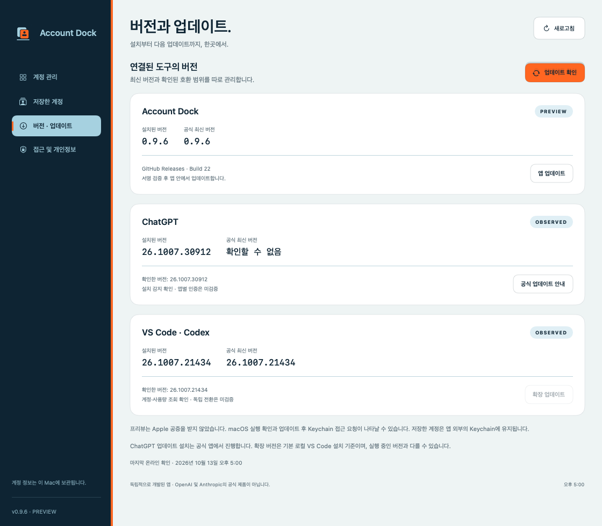

<p align="center">
  
</p>
<h1 align="center">Account Dock</h1>
<p align="center">내 계정, 한눈에.<br />macOS에서 Codex 계정을 관리하고, VS Code를 다른 계정으로 사용하세요.</p>
<p align="center">
  <a href="https://github.com/z8086486/account-dock/releases"></a>
  
  
  
</p>
<p align="center">
  <a href="https://github.com/z8086486/account-dock/releases">다운로드</a> ·
  <a href="#시작하기">시작하기</a> ·
  <a href="#지원-범위">지원 범위</a> ·
  <a href="https://github.com/z8086486/account-dock/issues">버그 제보</a>
</p>


> 개발 프리뷰입니다. 화면의 계정과 사용량은 설명용 예시입니다. Account Dock은 OpenAI·Anthropic과 제휴하지 않은 독립 프로젝트입니다.

## 주요 기능

- **계정을 한곳에** — 브라우저 로그인으로 계정을 추가하고, 이름을 지정해 macOS Keychain에 저장합니다.
- **VS Code 전용 창** — 기존 VS Code 계정은 유지하면서 다른 계정의 독립 창을 엽니다. 기본 프로필의 테마와 로컬 대화 기록을 연결합니다.
- **사용량 확인** — Codex 사용 한도와 초기화 시각, 제공되는 크레딧 정보를 계정별로 확인합니다. 계정 추가·메뉴 진입 시 자동으로 병렬 조회합니다.
- **작업 중 변경 방지** — 전용 창이 실행 중이면 인증을 교체하지 않습니다. 인증이 만료되거나 검증에 실패한 경우에도 변경을 중단합니다.
- **앱 내 업데이트** — GitHub에 공개된 업데이트의 서명을 확인하고, 다운로드·앱 교체·재실행을 진행합니다.

## 설치

**macOS 14 이상 · Apple Silicon(M 시리즈)**

1. [Releases](https://github.com/z8086486/account-dock/releases)에서 최신 `arm64-preview.dmg`를 다운로드합니다.
2. DMG를 열고 **Account Dock.app**을 Applications 폴더로 옮깁니다.
3. 앱을 실행하고 첫 접근 안내를 완료합니다.

공식 ChatGPT 앱 또는 VS Code의 공식 Codex 확장(`openai.chatgpt`)에 포함된 로컬 Codex 실행 파일이 필요합니다. VS Code 전용 창 기능에는 `/Applications`에 설치된 Visual Studio Code와 Codex 확장이 필요합니다. 앱 실행에 Python이나 Xcode는 필요하지 않습니다. Intel용 설치 파일은 아직 제공하지 않습니다.

프리뷰는 Apple 공증을 받지 않았으므로 macOS가 실행 확인을 요구하거나 차단할 수 있습니다. 업데이트 서명과 Apple 공증은 별개이며, 앱은 시스템 보안 설정을 자동으로 변경하지 않습니다.

## 시작하기

1. **계정 추가**에서 브라우저로 로그인합니다. 기존 앱의 로그인은 유지됩니다. 읽을 수 있는 현재 공유 Codex 계정은 자동 등록됩니다.
2. **저장한 계정 → 이름 변경**에서 개인용·업무용처럼 구분하기 쉬운 이름을 지정합니다.
3. **계정 관리 → VS Code · Codex**에서 사용할 계정을 선택하고 **선택한 계정으로 전용 창 열기**를 누릅니다.
4. 전용 VS Code의 Codex 설정에서 실제 로그인 계정을 확인합니다.

기존·전용 VS Code에 이미 연결된 계정은 선택 후보에서 제외됩니다. 다른 계정으로 전용 창을 열려면 먼저 기존 전용 창의 작업을 저장하고 종료하세요.

테마는 기본 프로필에서 가져오며, 로컬 대화의 추가·이름 변경·보관은 기존 창과 전용 창 양쪽에 반영됩니다. 같은 대화에서 동시에 작업하지 마세요. 전체 설정과 MCP 인증까지 복사하지는 않습니다. [전용 창 동작 자세히 보기 →](ISOLATION.md)

## 저장한 계정과 사용량


계정별 이름 편집·삭제와 사용량 조회를 제공합니다. 계정을 목록에서 삭제해도 현재 앱에서 로그아웃되지는 않습니다. 메뉴를 다시 누르면 해당 화면의 정보가 새로고침됩니다.

표시되는 한도는 **Codex 기준**입니다. ChatGPT 전체 대화 한도나 API 결제 잔액을 의미하지 않습니다. 계정에서 크레딧 수치를 제공하지 않으면 잔액을 추정하지 않고 제공된 상태만 표시합니다. 인증이 만료되면 해당 계정을 다시 추가해 로그인하세요.

## 업데이트



**버전 · 업데이트 → 앱 업데이트**에서 새 버전을 확인하고 설치합니다. Sparkle이 서명된 피드와 업데이트 파일을 검증한 뒤 기존 앱을 교체하고 다시 실행합니다. 계정 작업 중에는 재실행을 미룹니다.

- **0.9.4 및 이전 버전:** 앱 내 설치 기능이 없어 최신 DMG로 한 번 직접 교체해야 합니다. 기존 설치 위치가 `~/Applications`라면 같은 위치를 사용하세요.
- **저장 계정:** 앱 외부의 Keychain에 유지됩니다. 프리뷰 서명이 바뀌면 macOS가 접근 허용을 다시 요청할 수 있습니다.
- **외부 도구:** Codex 확장은 공식 VS Code 설치 도구로 업데이트합니다. ChatGPT 앱은 공식 앱의 업데이트 기능을 사용합니다. 새 버전의 호환성을 자동으로 보장하지는 않습니다.

## 지원 범위

| 대상 | 현재 지원 |
| --- | --- |
| VS Code · Codex | 로컬 인증 저장소 조회, 저장 계정 관리, 독립 전용 창, 테마·로컬 대화 연결 |
| ChatGPT · macOS | 설치 버전과 내부 Codex 저장소의 참고 정보 표시. **앱 자체 로그인 조회·전환은 미지원** |
| Anthropic Claude | 향후 지원 예정. 인증 연동 방식 조사 후 추가 |

앱별 계정 표시는 **로컬 인증 저장소 기준**이며 실행 중 세션을 직접 확인한 결과는 아닙니다. 현재는 로컬·파일 방식 Codex 인증을 지원합니다. API 키, Codex의 Keychain/auto 인증 저장 방식, 원격 SSH·WSL 환경은 저장 계정 전환 대상이 아닙니다. 깨끗한 Mac과 모든 지원 macOS 버전에서의 설치 검증은 아직 완료하지 않았습니다.

## 개인정보와 접근

인증 정보는 이 Mac의 Keychain에 저장하며 GitHub로 업로드하지 않습니다. 온라인 사용량 조회는 저장한 계정으로 OpenAI에 인증해 요청하며, **접근 및 개인정보**에서 끌 수 있습니다. 현재 기능에는 전체 디스크 접근·화면 기록·손쉬운 사용 권한이 필요하지 않습니다.

첫 실행에 필요한 접근과 이유를 안내합니다. Keychain 요청에서 **항상 허용**을 선택하면 이후 접근에도 적용되지만, 서명 변경·Keychain 잠금·권한 철회 시에는 다시 확인이 필요할 수 있습니다.

## 개발

Swift 6 이상과 Xcode 또는 Command Line Tools가 필요합니다.

```sh
git clone https://github.com/z8086486/account-dock.git
cd account-dock
swift run AccountDock
```

```sh
swift test
python3 -m unittest discover -s tests -v
python3 scripts/package_app.py --dmg
```

Python은 개발용 테스트·패키징에만 사용합니다. 공개 저장소에는 제품 소스·테스트·문서·화면 이미지·업데이트 피드만 포함하며, 인증 정보와 로컬 작업 기록은 제외합니다.

[배포 가이드](RELEASING.md) · [지원·검증 체크리스트](RELEASE_CHECKLIST.md) · [ChatGPT 연동 계획](CHATGPT_INTEGRATION.md)
