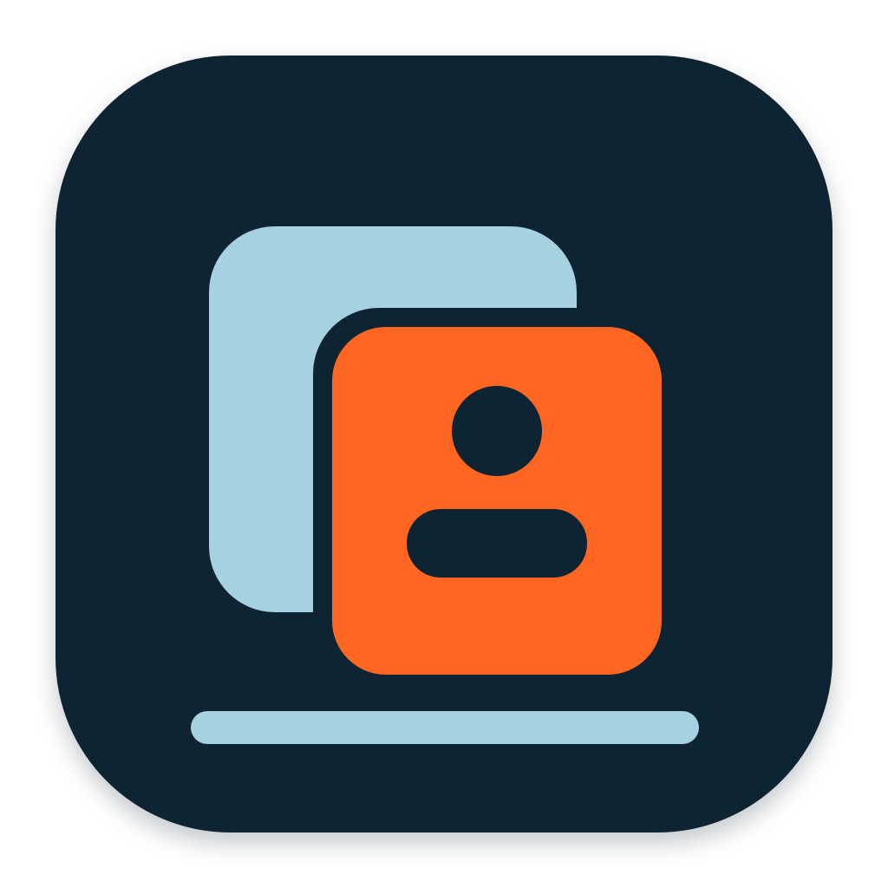
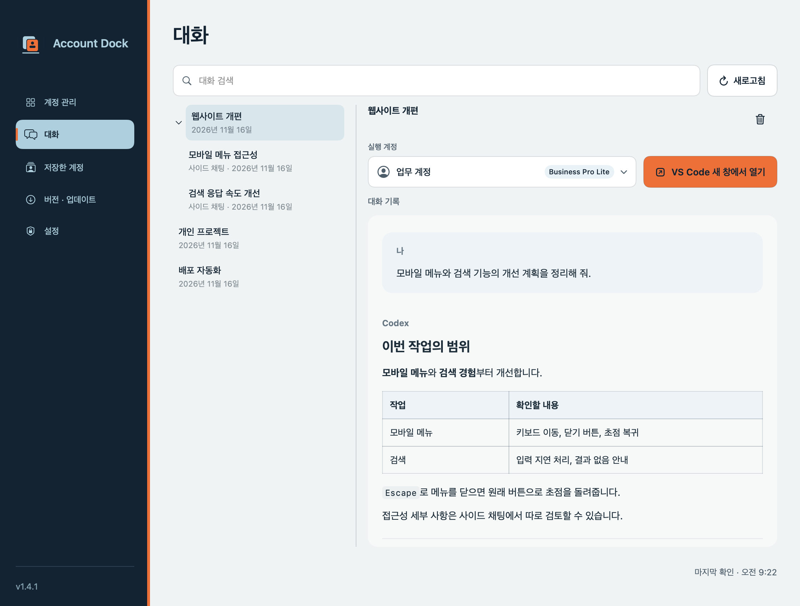
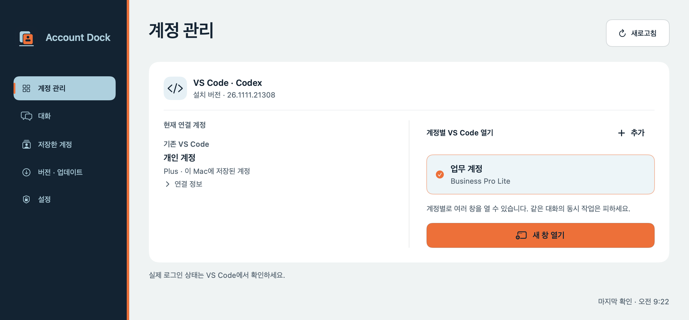
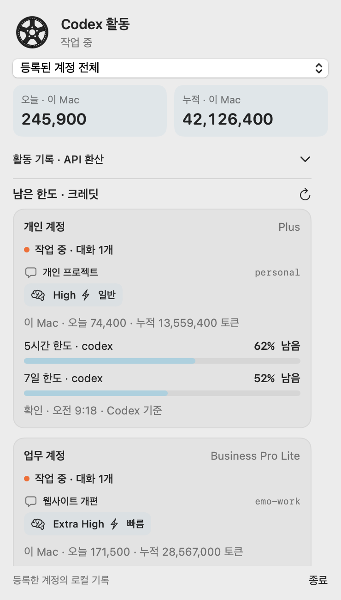
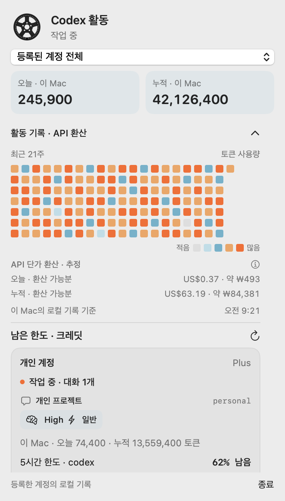
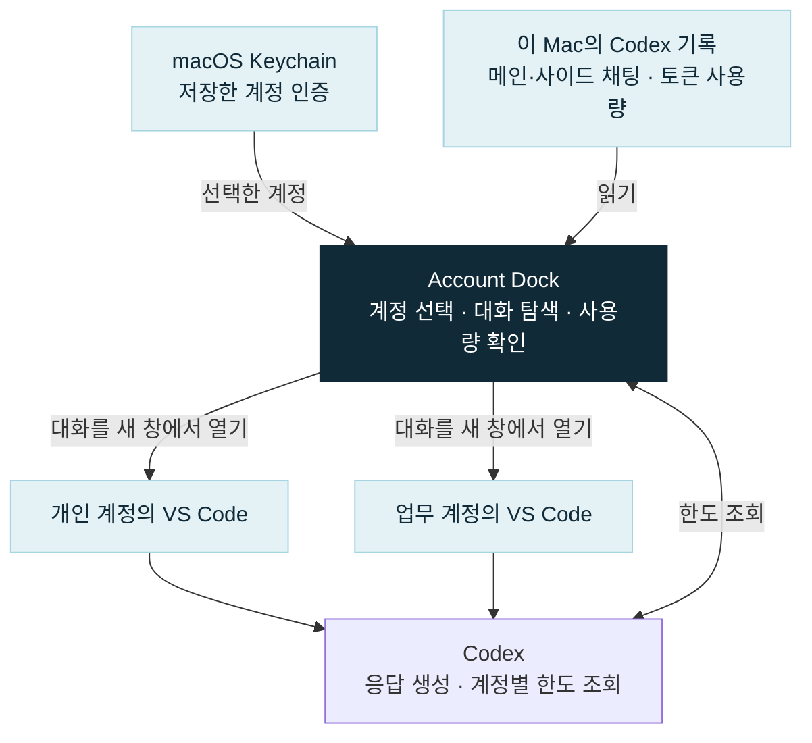

<p align="center">
  
</p>
<h1 align="center">Account Dock</h1>
<p align="center"><strong>여러 Codex 계정과 대화를 한곳에서 관리하는 macOS 앱</strong></p>
<p align="center">이어갈 대화를 찾고, 사용할 계정을 골라, 새 VS Code 창에서 작업하세요.</p>
<p align="center">
  <a href="https://github.com/z8086486/account-dock/releases/latest"></a>
  
  
  <a href="LICENSE"></a>
</p>
<p align="center">
  <a href="https://github.com/z8086486/account-dock/releases/latest">다운로드</a> ·
  <a href="#시작하기">시작하기</a> ·
  <a href="https://github.com/z8086486/account-dock/issues">버그 제보</a>
</p>

개인 계정과 업무 계정을 번갈아 쓰거나, 여러 대화를 동시에 진행하고 있나요? Account Dock에서 **계정마다 별도의 VS Code를 열고**, **기존 대화를 원하는 계정으로 이어가고**, **남은 사용 한도를 확인**할 수 있습니다.



## 대화를 찾아서, 원하는 계정으로 이어가기

**대화**에서 이 Mac에 저장된 Codex 대화를 검색하고, 메인 대화와 하위 사이드 채팅을 함께 확인합니다. 코드·표·목록은 마크다운으로 읽을 수 있습니다.

1. 이어갈 대화를 선택합니다.
2. **실행 계정**을 고릅니다.
3. **VS Code 새 창에서 열기**를 누르면 선택한 대화가 새 창에 열립니다.

본문에서 궁금한 부분을 드래그하고 **사이드 채팅에 질문하기**를 누르면, 원본 문맥을 이어받는 하위 대화를 만들 수 있습니다. 질문 입력과 응답 생성은 선택한 계정의 VS Code에서 진행합니다.

## 계정마다 작업 공간 나누기

**계정 관리**에서 저장한 계정으로 VS Code를 실행합니다. 개인·업무 계정으로 동시에 작업하거나, 같은 계정으로 창을 여러 개 열 수 있습니다. 기존 VS Code의 테마와 로컬 대화도 연결됩니다.



**저장한 계정**에서는 알아보기 쉬운 이름을 지정하고, 플랜과 남은 한도를 확인합니다. 인증 정보는 macOS Keychain에 보관합니다.

## 작업 상태와 남은 한도를 메뉴바에서

Codex가 응답을 생성하면 메뉴바 아이콘이 움직입니다. 클릭하면 **계정별 진행 중인 대화**, **추론 수준·빠른 응답 설정**, **남은 한도**를 확인할 수 있습니다.

<p align="center">
  
  
</p>

**활동 기록 · API 환산**을 펼치면 날짜별 토큰 사용량과 예상 비용을 볼 수 있습니다. 날짜 칸에 마우스를 올려 상세 내역을 확인하고, 새로고침으로 한도를 바로 조회하세요.

<p align="center">
  
</p>
<p align="center"><sub>동시 작업 수에 따라 달라지는 회전 속도 예시</sub></p>

> 스크린샷은 v1.4.1 화면에 예시 계정·대화·사용량을 넣어 촬영했습니다. GIF는 회전 동작 예시입니다.

## 시작하기

**macOS 14 이상 · Apple Silicon · VS Code와 공식 Codex 확장**이 필요합니다. VS Code는 `/Applications`에 설치해 주세요.

1. [최신 릴리스](https://github.com/z8086486/account-dock/releases/latest)에서 **DMG**를 내려받습니다.
2. **Account Dock.app**을 **응용 프로그램** 폴더로 옮겨 실행합니다.
3. 첫 실행 안내를 마친 뒤 **계정 추가**에서 사용할 계정으로 로그인합니다.
4. **계정 관리**에서 창을 열거나, **대화**에서 기존 대화를 선택해 시작합니다.

이후 업데이트는 앱의 **버전 · 업데이트 → 앱 업데이트**에서 설치합니다. Python이나 Xcode를 별도로 설치할 필요는 없습니다.

> Apple Developer ID 서명·공증은 적용하지 않았습니다. macOS에서 실행을 차단하면 **시스템 설정 → 개인정보 보호 및 보안**에서 실행을 허용해야 할 수 있습니다. 첫 Keychain 접근 시에도 승인이 필요할 수 있습니다.

## 어떻게 연결되나요?



계정별 VS Code는 인증 환경을 분리하고, 이 Mac의 로컬 대화 기록을 연결합니다. Account Dock은 대화를 탐색하고 열어 주며, 실제 대화는 VS Code의 Codex에서 이어갑니다. 자세한 동작은 [계정별 VS Code 안내](ISOLATION.md)를 참고하세요.

### 사용량을 읽는 기준

- **남은 한도·크레딧**은 Codex가 제공하는 계정별 조회 값입니다.
- **오늘·누적 토큰**은 등록한 계정으로 식별할 수 있는 **이 Mac의 로컬 기록** 기준입니다. 계정 전체나 다른 기기의 사용량과는 다를 수 있습니다.
- **API 단가 환산**은 모델·토큰 세부 내역이 확인된 기록에 가격표와 환율을 적용한 추정액입니다. 실제 청구액이 아닙니다. 적용 기준과 환산 범위는 패널의 ⓘ에서 확인할 수 있습니다.

같은 대화를 여러 창에서 동시에 실행하는 것은 피하세요. Account Dock에서 대화를 삭제하면 해당 로컬 기록은 복구할 수 없습니다.

<details>
<summary>소스에서 빌드하기</summary>

macOS 26 SDK를 포함한 Xcode 26 이상 또는 해당 Command Line Tools가 필요합니다.

```sh
git clone https://github.com/z8086486/account-dock.git
cd account-dock
swift run AccountDock
swift test
```

패키징 방법은 [배포 가이드](RELEASING.md)를 참고하세요.

</details>

## 라이선스

[MIT License](LICENSE) · [외부 구성요소 고지](THIRD_PARTY_NOTICES.md)
